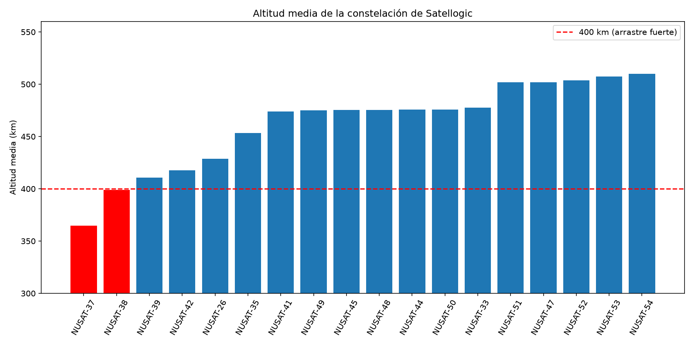
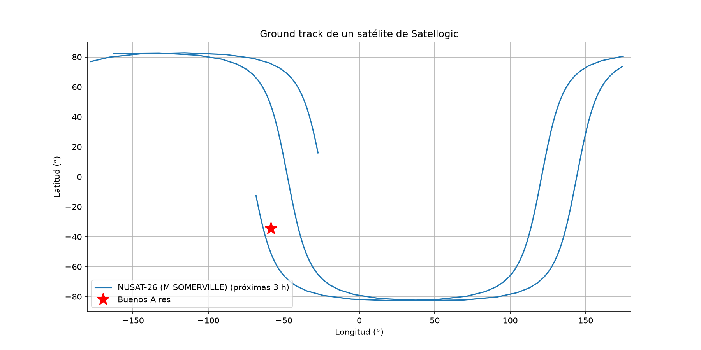

# Satellogic Constellation Monitor

Python tool that monitors the Satellogic (ÑuSat / Aleph-1) Earth-observation constellation using public TLE data from CelesTrak.

## What it does

1. **Downloads** the latest TLEs from CelesTrak and keeps only Satellogic satellites (`NUSAT-*`), filtering out unrelated objects with similar names (e.g. SNUSAT-2).
2. **Propagates** each orbit with SGP4 (via Skyfield) to compute current latitude, longitude and altitude.
3. **Predicts passes** over a ground station in Buenos Aires for the next 24 h (elevation > 10°): start time (AOS), maximum elevation and duration.
4. **Plots the ground track** of a satellite over the next 3 hours.
5. **Computes the mean altitude** of every satellite from the TLE mean motion (Kepler's third law) and flags satellites below 400 km.
6. **Writes a daily report** to a text file with alerts, altitudes and passes, with no manual steps.

## Sample results





Observations from TLEs of 5 Oct 2026:

- All satellites are in sun-synchronous orbits (i ≈ 97.2–97.4°), so the ground track never exceeds ≈ 83° latitude.
- Satellites are grouped in altitude "steps" (~475 km and ~505 km), consistent with deployment in launch batches.
- NUSAT-37 (≈ 365 km) and NUSAT-38 (≈ 399 km) are below 400 km, where atmospheric drag accelerates orbital decay.
- Passes over Buenos Aires cluster in two daily time windows, a consequence of the sun-synchronous geometry.

## How to run

```
python -m venv .venv
.venv\Scripts\activate
pip install skyfield numpy matplotlib requests
python satelites.py
```

Outputs: `ground_track.png`, `altitud_constelacion.png` and `reporte_YYYY-MM-DD.txt`.
Code comments and outputs are in Spanish.

## Limitations

- TLE/SGP4 accuracy is on the order of a few km and degrades as the TLE ages; it is suitable for monitoring and pass prediction, not for precise orbit determination.
- Mean altitude is computed with the equatorial Earth radius and does not account for Earth's oblateness.
- The ground station uses fixed Buenos Aires coordinates and a 10° elevation mask.

## About

Developed by Wenndy Paola Limachi Zabala, Aeronautical Engineering student at UTN Facultad Regional Haedo (Argentina).
Built with AI assistance.
